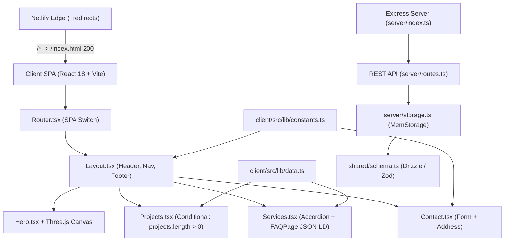

# DualSpark Studio — Project Index & Architecture Map

> **AI AGENT / DEVELOPER DIRECTIVE:**
> When responding to any prompt, bug report, or feature request on this project, **consult this index FIRST** before exploring files or running broad searches. Use the **Lookup Intent Matrix** below to jump directly to the target file and line.

---

## 1. Quick-Lookup Intent Matrix ("Where to Look When...")

| Task / Intent | Primary File to Check / Edit | Secondary / Dependent Files |
| :--- | :--- | :--- |
| **Change Company Name, Partner Names, Location** | `client/src/lib/constants.ts` `client/src/components/Services.tsx` (FAQ) | `client/index.html` (JSON-LD) `client/public/llms.txt` |
| **Edit Contact Info (Phone, Email, Address)** | `client/src/lib/constants.ts` `client/src/components/Contact.tsx` | `client/index.html` (JSON-LD) `client/public/llms.txt` |
| **Update / Add Portfolio Projects** | `client/src/lib/data.ts` (`projects` array) | `client/src/components/Projects.tsx` `shared/schema.ts` (`Project` type) |
| **Edit Services Offered or FAQ Text** | `client/src/components/Services.tsx` (accordion & JSON-LD) `client/src/lib/data.ts` (`services` array) | `client/public/llms.txt` |
| **SEO, Canonical URL, Meta Tags, Structured Data** | `client/index.html` (Meta, OpenGraph, JSON-LD) `client/src/components/Services.tsx` (FAQPage JSON-LD) | `client/public/robots.txt` `client/public/sitemap.xml` |
| **AI Crawlers & LLM Directives (AEO / GEO)** | `client/public/llms.txt` `client/public/robots.txt` | `client/index.html` |
| **Routing & URL Handling (Unknown routes, `/admin`, etc.)** | `client/src/components/Router.tsx` | `client/public/_redirects` `client/src/pages/` |
| **Netlify Deployment, SPA Rewrites & Redirects** | `client/public/_redirects` | `client/src/components/Router.tsx` |
| **3D Background, Shaders, WebGL Particles** | `client/src/components/ThreeBackground.tsx` `client/src/components/ShootingStars.tsx` | `client/src/components/Hero.tsx` `client/src/components/FloatingObject.tsx` |
| **Audio, Sound Effects & Background Music** | `client/src/lib/stores/useAudio.tsx` | `client/src/components/Layout.tsx` |
| **Styling, Color Themes, Fonts & Animations** | `client/src/index.css` `tailwind.config.ts` | `client/src/lib/stores/useTheme.ts` |
| **Backend API Endpoints & Server Storage** | `server/routes.ts` `server/storage.ts` | `shared/schema.ts` `server/index.ts` |
| **Database Schema & Types (Project, Contact, User)** | `shared/schema.ts` | `server/storage.ts` `client/src/lib/data.ts` |

---

## 2. System Architecture & Tech Stack

- **Frontend Framework**: React 18 with TypeScript, bundled by Vite.
- **Styling**: Tailwind CSS, PostCSS, Framer Motion, and GSAP.
- **3D Graphics & Creative Tech**: Three.js, React Three Fiber (R3F), GLSL Shaders, `@react-three/drei`.
- **Backend**: Express.js with Node.js and TypeScript.
- **Data Layer / ORM**: Drizzle ORM with Zod validation (`shared/schema.ts`).
- **Hosting / Deployment Target**: Netlify (Frontend SPA with edge `_redirects`).

---

## 3. Detailed File & Folder Inventory

### 3.1 Root Configuration
- [`package.json`](file:///c:/work/DualSparkStudio/package.json): Project dependencies, build scripts (`npm run dev`, `npm run build`, `npm run check`).
- [`tsconfig.json`](file:///c:/work/DualSparkStudio/tsconfig.json): TypeScript configuration and path aliases (`@/*` -> `client/src/*`, `@shared/*` -> `shared/*`).
- [`vite.config.ts`](file:///c:/work/DualSparkStudio/vite.config.ts): Vite build configuration, asset chunking, plugins, and path resolution.
- [`tailwind.config.ts`](file:///c:/work/DualSparkStudio/tailwind.config.ts): Tailwind design tokens, typography, animations, and color scheme.
- [`PROJECT_INDEX.md`](file:///c:/work/DualSparkStudio/PROJECT_INDEX.md): This file — master index and lookup directory.

---

### 3.2 Client Root (`client/`)
- [`client/index.html`](file:///c:/work/DualSparkStudio/client/index.html):
  - Primary HTML document mounted by Vite.
  - SEO Meta tags (Title, Description, Keywords, Robots, Canonical).
  - OpenGraph and Twitter card metadata.
  - Schema.org structured data: `ProfessionalService` JSON-LD (Name, locality, region, country, phone, email, sameAs).

---

### 3.3 Public Assets & Crawlers (`client/public/`)
- [`client/public/_redirects`](file:///c:/work/DualSparkStudio/client/public/_redirects):
  - Netlify SPA rewrite directive: `/* /index.html 200`.
  - Google verification bypass: `/google3516721451dfac13.html /google3516721451dfac13.html 200!`.
- [`client/public/llms.txt`](file:///c:/work/DualSparkStudio/client/public/llms.txt): Plaintext specification for AI search agents and LLM crawlers outlining core studio capabilities, services, tech stack, and verified contact info.
- [`client/public/robots.txt`](file:///c:/work/DualSparkStudio/client/public/robots.txt): Search engine crawler directives (`Allow: /`, `Disallow: /admin`).
- [`client/public/sitemap.xml`](file:///c:/work/DualSparkStudio/client/public/sitemap.xml): XML sitemap listing indexable routes.
- [`client/public/textures/`](file:///c:/work/DualSparkStudio/client/public/textures/): PBR textures and skyboxes for 3D canvases.
- [`client/public/geometries/`](file:///c:/work/DualSparkStudio/client/public/geometries/): GLTF 3D model files.

---

### 3.4 Core Frontend Source (`client/src/`)

#### Main Entry & Shell
- [`client/src/main.tsx`](file:///c:/work/DualSparkStudio/client/src/main.tsx): React DOM root mount.
- [`client/src/App.tsx`](file:///c:/work/DualSparkStudio/client/src/App.tsx): Top-level providers (`QueryClientProvider`, `ThemeProvider`, `TooltipProvider`, audio sound initialization).
- [`client/src/index.css`](file:///c:/work/DualSparkStudio/client/src/index.css): Global CSS, Tailwind layers, custom scrollbars, and keyframe animations.

#### Page Components & Layouts
- [`client/src/components/Router.tsx`](file:///c:/work/DualSparkStudio/client/src/components/Router.tsx):
  - Client-side SPA routing based on `window.location.pathname`.
  - Routes: `/admin` (Admin), `/contact-only` (ContactButtons), `default:` (`<Layout />`).
- [`client/src/components/Layout.tsx`](file:///c:/work/DualSparkStudio/client/src/components/Layout.tsx):
  - Main shell containing header, desktop/mobile navigation, sound mute toggle, and back-to-top button.
  - Dynamically hides `'projects'` from the navigation bar when `projects.length === 0`.
  - Conditioned `<Projects />` section mounting on `projects.length > 0`.
- [`client/src/components/Hero.tsx`](file:///c:/work/DualSparkStudio/client/src/components/Hero.tsx):
  - Main landing viewport.
  - GSAP headline animations, 3D Canvas integration (`ThreeBackground`), and CTA buttons ("View Our Work", "Contact Us").
- [`client/src/components/Projects.tsx`](file:///c:/work/DualSparkStudio/client/src/components/Projects.tsx):
  - Portfolio project grid.
  - Returns `null` when `projects.length === 0`.
  - Renders project card image, tags, and live external links.
- [`client/src/components/Services.tsx`](file:///c:/work/DualSparkStudio/client/src/components/Services.tsx):
  - Interactive service cards.
  - Expandable FAQ Accordion.
  - Embedded `application/ld+json` Schema.org `FAQPage` structured data.
- [`client/src/components/Contact.tsx`](file:///c:/work/DualSparkStudio/client/src/components/Contact.tsx):
  - Inquiry contact form connected to backend.
  - Email, phone, and single-line address ("Pune, Maharashtra, India").
  - Social media profile links.

#### 3D Graphics & Visual Effects (`client/src/components/`)
- [`client/src/components/ThreeBackground.tsx`](file:///c:/work/DualSparkStudio/client/src/components/ThreeBackground.tsx): Three.js particle wave canvas with custom GLSL vertex and fragment shaders.
- [`client/src/components/ShootingStars.tsx`](file:///c:/work/DualSparkStudio/client/src/components/ShootingStars.tsx): Three.js mesh animations for falling shooting star particles.
- [`client/src/components/FloatingObject.tsx`](file:///c:/work/DualSparkStudio/client/src/components/FloatingObject.tsx): Orbiting, rotatable 3D shapes (cubes, spheres) accenting section margins.
- [`client/src/components/Particles.tsx`](file:///c:/work/DualSparkStudio/client/src/components/Particles.tsx): Ambient background particle cloud.
- [`client/src/components/PageTransition.tsx`](file:///c:/work/DualSparkStudio/client/src/components/PageTransition.tsx): Full-screen WebGL transition effect for smooth section switching.
- [`client/src/components/PerformanceMonitor.tsx`](file:///c:/work/DualSparkStudio/client/src/components/PerformanceMonitor.tsx): Frame rate (FPS) and render performance overlay.

#### Data & State Libraries (`client/src/lib/`)
- [`client/src/lib/constants.ts`](file:///c:/work/DualSparkStudio/client/src/lib/constants.ts):
  - Canonical contact details: phone numbers, email, structured address.
  - Social links (`SOCIAL_LINKS`: GitHub, LinkedIn, Instagram).
  - Navigation anchors (`NAV_ITEMS`).
- [`client/src/lib/data.ts`](file:///c:/work/DualSparkStudio/client/src/lib/data.ts):
  - `projects`: Master array of client projects (type `Project[]`).
  - `services`: Master list of services and feature bullet points (type `Service[]`).
- [`client/src/lib/stores/useAudio.tsx`](file:///c:/work/DualSparkStudio/client/src/lib/stores/useAudio.tsx): Zustand audio player and SFX manager.
- [`client/src/lib/stores/useTheme.ts`](file:///c:/work/DualSparkStudio/client/src/lib/stores/useTheme.ts): Dark/light mode theme store.
- [`client/src/lib/utils.ts`](file:///c:/work/DualSparkStudio/client/src/lib/utils.ts): Tailwind `cn` helper merging `clsx` and `tailwind-merge`.

#### UI Component Library (`client/src/components/ui/`)
- Standard Accessible Shadcn / Radix UI primitives: `accordion`, `button`, `card`, `dialog`, `input`, `textarea`, `tabs`, `sonner`, `sheet`, etc.

#### Pages (`client/src/pages/`)
- [`client/src/pages/Admin.tsx`](file:///c:/work/DualSparkStudio/client/src/pages/Admin.tsx): Admin authentication and dashboard gateway.
- [`client/src/pages/AdminDashboard.tsx`](file:///c:/work/DualSparkStudio/client/src/pages/AdminDashboard.tsx): CMS panel for live project management.
- [`client/src/pages/ContactButtons.tsx`](file:///c:/work/DualSparkStudio/client/src/pages/ContactButtons.tsx): Minimal mobile contact tree (`/contact-only`).
- [`client/src/pages/not-found.tsx`](file:///c:/work/DualSparkStudio/client/src/pages/not-found.tsx): 404 page template.

---

### 3.5 Shared Schema (`shared/`)
- [`shared/schema.ts`](file:///c:/work/DualSparkStudio/shared/schema.ts):
  - Drizzle ORM schema for PostgreSQL:
    - `projects`: id, title, description, imageUrl, technologies, category, link, githubLink, featured.
    - `services`: id, title, description, icon, features.
    - `contacts`: id, name, email, message, createdAt.
    - `users`: id, username, password.
  - Zod insert schemas (`insertProjectSchema`, `insertContactSchema`, `insertUserSchema`).
  - TypeScript types (`Project`, `Service`, `Contact`, `User`).

---

### 3.6 Server Backend (`server/`)
- [`server/index.ts`](file:///c:/work/DualSparkStudio/server/index.ts): Express server entry point, logging middleware, static file serving, and port binding.
- [`server/routes.ts`](file:///c:/work/DualSparkStudio/server/routes.ts): REST API endpoints:
  - `GET /api/projects`, `POST /api/projects`, `PUT /api/projects/:id`, `DELETE /api/projects/:id`.
  - `GET /api/services`.
  - `POST /api/contact`.
- [`server/storage.ts`](file:///c:/work/DualSparkStudio/server/storage.ts): Storage engine (`MemStorage`) implementing `IStorage`. Loads initial state from `client/src/lib/data.ts`.
- [`server/vite.ts`](file:///c:/work/DualSparkStudio/server/vite.ts): Vite development server middleware integration for hot module replacement (HMR).

---

## 4. Key Verified Facts (Source of Truth)

- **Firm Name**: DualSpark Studio
- **Structure**: Partnership firm
- **Partners**: Yash Vilas Karanjule & Sahil Ramchandra Dhangadwade
- **Headquarters / Base**: Pune, Maharashtra, India (serving clients everywhere)
- **Primary Contacts**:
  - Phone / WhatsApp: `+91 9270269875`
  - Email: `dualsparkstudio@gmail.com`
  - Official Domain: `https://dualsparkstudio.com/`
  - GitHub: `https://github.com/dualsparkstudio`
- **Core Domain Expertise**:
  - Full-stack custom website and software development.
  - Resort, hotel, and luxury villa booking platforms.
  - Backend engineering (notably the backend platform for *The Lead Hunter Club*).
  - High-performance 3D interactive WebGL and Three.js experiences.

